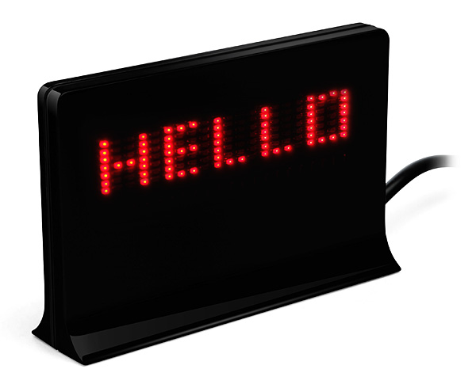

# DreamCheekyLED

## A "Free as in speech" library for easy integration with a ThinkGeek classic

 Image credit: [Thinkgeek](https://web.archive.org/web/20140120004039/http://www.thinkgeek.com/product/1690)

This project is mostly a framework to get developers (and yes, AI too) a major "head start" in creating software packages of *all* kinds for the DreamCheeky LED Message Board. It also includes a super-simple console app that you can pass filepaths to in order to display static GIF/PNG images, or even animated GIF images! Images should display as expected as long as they're a 21x7 ratio -- more details on how the scaling works in the [ImageLoader](https://naomitr0n.github.io/DreamCheekyLED/detailed_usage.html#the-imageloader---dreamcheekyledextras-library) part of the [detailed usage guide](https://naomitr0n.github.io/DreamCheekyLED/detailed_usage.html).

This project uses two NuGet packages: HidSharp for the USB protocol handling, and (optionally) SkiaSharp for loading animated or static images.

Many, *many* thanks goes to those that have preserved and shared the Manufacturer's Hardware Developer Manual, including [Lewis Clayton](https://github.com/Lewis-Clayton/dcled_ruby/blob/master/USB_LED_Message_Board_-_Developer_Manual_v1.0.pdf), [Dave Ingram](https://github.com/dingram/led-display/blob/master/USB%20LED%20Message%20Board%20-%20Developer%20Manual%20v1.0.pdf), and [Jeff Jahr](https://www.jeffrika.com/~malakai/dcled/USB%20LED%20Message%20Board%20-%20Developer%20Manual%20v1.0.pdf), which proved invaluable during this process.

# Want it fast?
Let's go fast. Check [the documentation](https://naomitr0n.github.io/DreamCheekyLED/)! Start with the [Quick Start Guide](https://naomitr0n.github.io/DreamCheekyLED/quickstart.html)!

# FASTER!!!
Check the [Releases](https://github.com/Naomitr0n/DreamCheekyLED/releases/latest) page for the ConsoleApp that you can send file paths to *and* example images to send it :) Proof it works!

# Debunking myths
It's weird that I'm even writing this, but on the Thinkgeek product page (archive.org of it [here](https://web.archive.org/web/20140120004039/http://www.thinkgeek.com/product/1690)), it states the following:

> - Stores up to 8 custom messages
> - Supports up to 12 bitmap images for custom graphic messages
> - 3 brightness levels
> - 5 scrolling modes: left, right, up, down, freeze, and flash
> - Speed setting
> - Displays black and white 21 x 7 pixel bitmaps

3 Brightness levels? Check. Displays black-and-white 21 x 7 pixel bitmaps? Check. The rest is *entirely* software. If you only send one screen of data one single time, it will time out after about 0.25 seconds and turn off entirely again. There is no "cache until input changes," but rather a "cache for 0.25 seconds, then reset." You ***must*** regularly send updates to the screen as a bit of a "keepalive". __**If your project shows an image for only about a quarter-second before going to a blank screen, this is why!**__ (It's also why most open source versions use a "service" of some kind -- background updates so it keeps displaying).

# License
This repository, [SkiaSharp](https://github.com/mono/skiasharp), and [docfx](https://github.com/dotnet/docfx) are all released under the MIT license.
See [LICENSE.md](LICENSE.md) for details.

[HidSharp](https://github.com/IntergatedCircuits/HidSharp) is released under the Apache 2.0 license. See [here](https://github.com/IntergatedCircuits/HidSharp?tab=License-1-ov-file) for details.